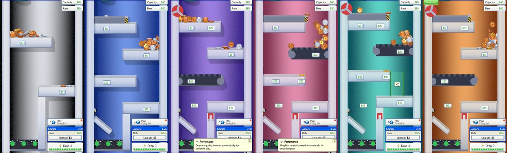
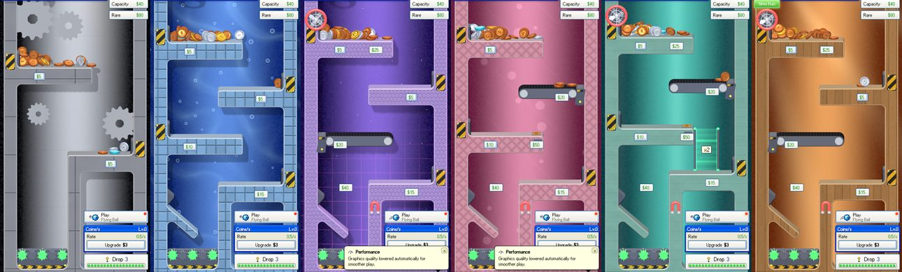

# 3D model overhaul

Every visible 3D model in the main machine was inspected and either rebuilt or replaced. The Flying Ball
mini-game is drawn on a 2D canvas and was not part of this pass. Physics colliders are unchanged:
`layout.js`, `physics.js` and `machines.js` were not modified. The visual meshes are separate objects,
sized so that the visible contact surfaces match the colliders.

## What changed per model
| Model | Before | After | Files |
|---|---|---|---|
| Side walls, platforms, funnel plate, support column, floor | Separate boxes pushed together: hard seams, square edges, one flat canvas gradient | **One seamless beveled structure** with fillets at every join, a rounded free end on each platform, the column and lowest platform as one base piece with an arched room below, and a themed surface (colour + normal map) plus a separate trim finish for tops and bevels. See [environment-design.md](environment-design.md) | `scene/geometry.js` `buildHouse` |
| Coins | Plain cylinders | **Lathe profile:** recessed face, raised rim, rounded edges (2-step bevel), outward normals. A milled dot ring and shading gradient on the face texture, and a highlight facet on the gem. Same radius and thickness as the Rapier cylinder; 22 sides for round coins, 8 for the octagonal rare coin | `scene/geometry.js` `coinGeometry`, `world.js` |
| Dispenser pipe | Three cylinders | **Lathe body** with a flared, rounded mouth, a clamp band, a dark interior (back faces + cap) and 8 chrome bolts. Clear-coated green plastic | `scene/props.js` `buildPipe` |
| Wall pistons | Box head, box rod, flat hazard decal | **Rounded housing** sticking out of the wall with a dark port; a 3D hazard mounting plate with bolts on the wall face; a **chrome cylinder rod**; a steel head with a rubber push pad and a hazard face plate. The sweeper follows the plate angle | `buildPiston` |
| Conveyor | Box with a striped top, two cylinders, cladding box | **Motor housing** on the wall end (flush top, hazard strip, status lamp); a **rounded belt loop** whose rubber tread scrolls with the belt speed (top and bottom move in opposite directions, like a real loop); spoked chrome hubs that spin | `buildBelt` |
| Air blower | Red disc + 3 flat boxes | Housing plate, **red torus ring**, 4 **pitched curved blades**, a chrome hub dome, a chrome grille. Wind streaks are soft-ended additive sprites | `buildFan`, `windStreak` |
| Magnet | 5 boxes | **Swept horseshoe** (a tube along a U curve) with chrome pole tips on a mounting plate. Additive pulse ring | `buildMagnet` |
| Launch pad | Flat plane + box spring | **Rounded chevron plate** on the platform, a framed window on the platform front with a **chrome coil spring** and cap that compress and extend | `buildLauncher` |
| Multiplier gate | Two boxes + a translucent plane | **Capsule posts** with glowing emitter spheres; an energy field shader (scanlines, edge glow, moving band, flash on pass) | `buildGate` |
| Grinder | Box + cylinders, each with 6 loose cone meshes | **Rounded housing**, a hazard lip, and toothed rollers: 18 teeth each, **one merged geometry per roller** (30 meshes became 5). Warning lamps | `buildGrinder` |
| Particles | Spinning cubes | Faceted shards (icosahedron) with slight drag | `world.js` |
| Back wall | One gradient shader | Six themed shaders with ambient effects, plus Steel Works gears | `scene/backdrop.js` |

## Technical implementation
- **Shared resources:**
  - Every fixed-size geometry is created once (`once()` cache in `props.js`) and reused on every stage.
  - Every material comes from one `MaterialLibrary`. House materials are cached per theme, and surface
    textures are cached per recipe.
- **Disposal:** per-stage geometries, cloned textures (belt tread, launch pad chevrons) and per-stage
  materials (belt tread, launch pad, gate field, magnet ring) are tracked in the stage record and disposed
  when the stage is swapped. A 30-swap stress test kept the geometry and texture counts constant (47 / 36),
  so nothing leaks.
- **Draw calls:** about half of before. The whole wall structure is one mesh (2 material groups), and the
  rollers and bolt rings are merged. Measured per frame, including the shadow pass:

  | Stage | Before | After |
  |---|---|---|
  | 1 | 119 | 48 |
  | 5 | 218 | 112 |

- **Triangles:** about 18k for the props of the busiest stage, 2.5k for the house, and 484 per coin.
  The old scene was about 6k in total. See [visual-quality-report.md](visual-quality-report.md) for the
  performance trade-off.
- **Transparency** is limited to the fan wind streaks, the magnet pulse ring and the gate field (all
  additive, no depth write).
- **Collision safety:** visuals never feed physics. Rounding is applied only where it cannot change what
  the player sees a coin rest on:
  - the platform top surfaces stay exactly on the collider tops (`bevelOffset = -bevel`),
  - the piston head plus pad fills exactly the collider box,
  - the belt top is flush with the belt block top.
