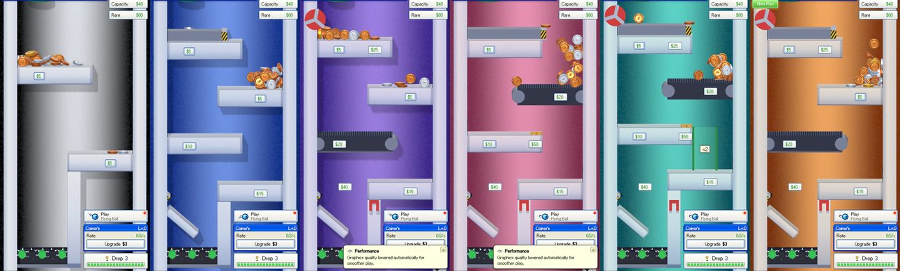
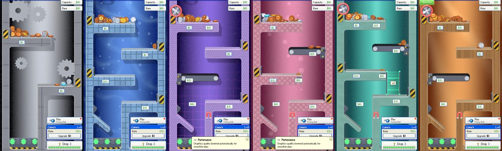
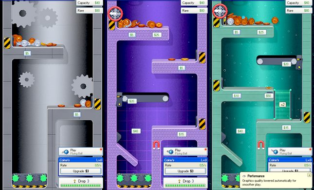
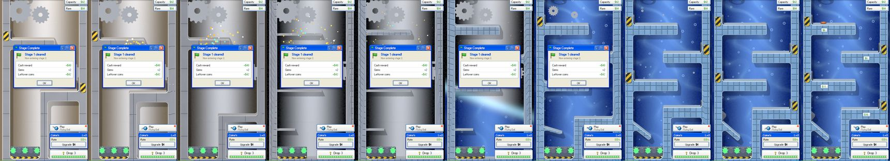
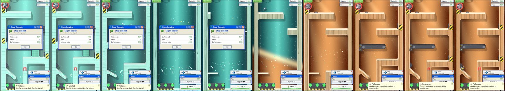

# Visual quality report

The rendered game was reviewed with headless Chromium (SwiftShader software GL) at several sizes:
- 430 × 900 (phone portrait),
- 820 × 1180 (tablet),
- 1280 × 800 (desktop).

Every stage theme was checked with the retro pixel filter both on and off, and stage transitions were
captured frame by frame.

## Before / after
| Before | After |
|---|---|
|  |  |

Pixel mode (default setting):

Stage transitions, 0.05 s to 2.3 s (Steel Works to Tide Pool, Bio Lab to Sun Workshop):

## Checklist results
| Check | Result |
|---|---|
| Wall corners and connections | One continuous surface. Fillets at every wall join, rounded free ends, matching bevels, no visible seams, no z-fighting |
| Material quality | Each theme has its own surface (steel panels, tiles, hex panelling, quilted candy, plaster cladding, wood planks). Metals reflect, rubber is matte, plastics are glossy |
| Model silhouettes | Pistons, belts, fan, magnet, spring, gate and pipe all have recognisable, rounded silhouettes |
| Shading artifacts | Coin normals were inverted in the first build (coins looked dark) and are fixed. None visible after that |
| Stage transitions | Distinct exit and entrance per theme, a back wall wipe, light and wall colour blends, and a celebration. The price labels hide during the move |
| Animation smoothness | All dt-driven with easing. Structures are still when idle; only lights and the back wall ambient move |
| Object intersections | The capital of the earlier separate column poked out of the platform edge; it was replaced by the merged base piece. None visible after that |
| Lighting consistency | Per-theme hemisphere, key and fill lights; no overexposed walls after tuning (the first pass with a scene-wide environment washed the walls out and was removed) |
| Mobile layout | Phone, tablet and desktop presentation modes all frame the machine correctly (the camera code is unchanged) |
| Regression | `npm test` (31 game + 15 account tests) passes. The browser end-to-end suite (51 checks, including no console errors) passes on the new build. Physics, economy, save and account code are untouched |

## Performance
Measured in **software rendering** (SwiftShader on CPU), stage 5 with about 40 coins, 430 × 900, average
ms per frame:

| | Before | After |
|---|---|---|
| High quality | 52 | 117 to 124 |
| Low quality (no shadows, no wall normal maps, no fill light, ambient effects reduced) | 38 | 85 |

The new scene costs about 2.2 times more **in a CPU rasterizer**. The breakdown:
- normal-mapped walls (about 30 ms),
- coins with the rim profile (about 30 ms),
- props (about 25 ms),
- shadows (about 25 ms).

A CPU rasterizer is not representative of phone GPUs (38k triangles and these materials are light for
any current GPU), but the cost was reduced where it was cheap to do:
- reflections only on metals,
- no roughness map on walls,
- no clear coat on walls,
- leaner coin and prop meshes,
- half the draw calls of before.

The existing automatic quality step-down still applies. The low tier now also drops wall normal maps,
the fill light and the extra ambient particles.

## Remaining issues and limits
- **Not measured on real phones or tablets.** Frame rate on low-end Android is the main open risk. If it
  is too slow, the next steps are:
  1. make the medium tier also drop wall normal maps,
  2. cap shadow casting to the house and coins,
  3. use a 16-sided coin.
- The candy (quilt) and arcade (hex) surface patterns are the busiest. They read well with the pixel
  filter on (the default) but can look slightly patterned when it is off.
- The Flying Ball mini-game was not redesigned. It is a 2D canvas game, not part of the 3D scene.
- Stage themes cycle every 6 stages. Stages 7 and later reuse the layouts of stages 3 to 5 with the
  cycled theme, as before.
- The tests were run in SwiftShader only. Lighting looks the same on GPUs, but real-device colour and
  brightness have not been checked.
